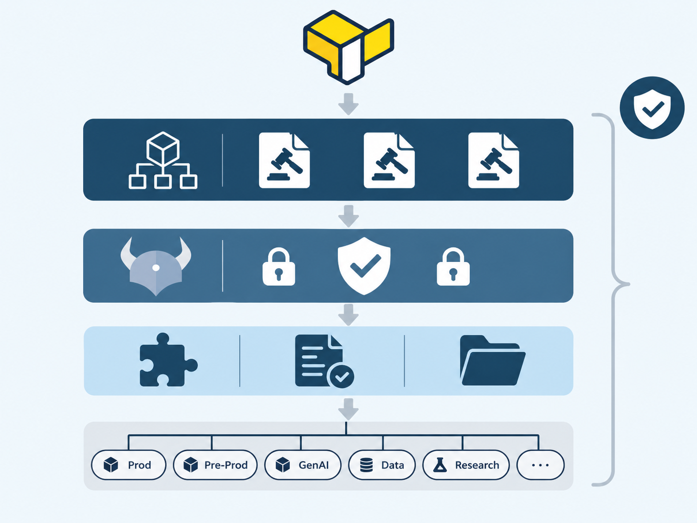

# Anestoa Infrastructure

**An example, reference implementation** of a multi-account AWS landing zone and environment
infrastructure for regulated industries. Compliance-by-default OpenTofu modules, a terraservice
pattern, and GitOps on AWS.



This is a reference monorepo: the **modules** are real, tested, and reusable; the **landing zone,
environment scaffolding, and CI/CD wiring** are reproducible patterns you adapt to your own AWS
organization. Clone it, keep what fits, swap the company-specific details, and it becomes your
foundation.

---

## Who this is for

Best-fit buyers are **early-stage technical teams — from pre-seed founders to Series A/B — in
regulated verticals** (healthtech, insurtech, fintech) deploying AI/LLM workloads that need
compliance from day one.

The common thread: they don't yet have a controlled, auditable AWS organization. They have a
management account and informal logging at best — and a compliance obligation (a BAA, a SOC 2
questionnaire, a PCI SAQ) that doesn't wait for an infra team to arrive. This repo shows how to
stand up a controlled, auditable posture **correctly the first time**, even before there's
dedicated headcount.

Compliance is enforced **by default**, not inspected after the fact — a small team can't
accidentally create a non-compliant resource, because the module defaults and organizational
guardrails refuse to.

---

## Compliance framework coverage

The 10 compliance pillars (see [CLAUDE.md](CLAUDE.md)) are designed as a **framework-agnostic
control baseline**. Every module enforces encryption, access control, network isolation, logging,
backup, retention, and auditability by default — regardless of which compliance framework you
target.

This means the same infrastructure covers **multiple frameworks simultaneously** without
framework-specific modules or variables:

| Framework | Infra controls required | Covered by |
|---|---|---|
| **HIPAA** (§164.312) | Encryption, access control, audit logs, integrity controls | Pillars 1, 2, 5, 8 |
| **SOC 2 Type II** (CC6.1, CC6.6, CC7.2) | Logical access, encryption, monitoring, change management | Pillars 1–6, 9 |
| **PCI DSS 4.0** (Req 3, 4, 7, 10) | Encrypt cardholder data, restrict access, log all access to CDE | Pillars 1, 2, 5, 8 |
| **ISO 27001** (Annex A.8–A.15) | Asset management, access control, cryptography, operations security | Pillars 1–8, 10 |
| **FDA 21 CFR Part 11** | Audit trails, access controls, electronic signature support | Pillars 2, 5, 8 |

The heavy lift for these frameworks is **procedural** — policies, risk assessments, annual audits,
employee training. The infrastructure layer (which this repo provides) handles the technical
controls that auditors check. A QSA or SOC 2 auditor will ask for:

- _"Show me that all data is encrypted at rest"_ → Pillar 1 — KMS key required on every resource
- _"Show me that production access is restricted"_ → Pillar 2 — least-privilege IAM with permissions boundaries
- _"Show me audit logs for the cardholder environment"_ → Pillar 5 + 8 — CloudTrail to immutable Object Lock bucket
- _"Show me your change management process"_ → Pillar 9 — Atlantis + OPA + approval gates

No framework-specific flags or modules are needed — the baseline controls satisfy all of them.
When an auditor asks for a specific control, the answer is "always on, not configurable."

---

## Design philosophy

This project exists to make one thing structurally impossible: **a developer provisioning a
non-compliant resource by accident.**

Early-stage regulated teams don't have a compliance officer watching every commit. So instead of
training people to *avoid* mistakes, we design the infrastructure so mistakes **can't** be made.
The controls are enforced at the layers nearest to where the resource is created, so a single
honest mistake — or a rushed PR — fails closed rather than shipping an incident:

| Layer | Catches | How |
|---|---|---|
| **Module defaults** | Mis-config at authoring time | KMS required, private subnets, no public IPs, deletion protection on, least-privilege IAM. The compliant thing is the only thing you can do. |
| **SCPs (organizational)** | Mis-config that slips past a module | Unencrypted resources denied. Public access denied. Root actions denied. SSM parameters protected. |
| **OPA (plan time)** | Mis-config before it reaches AWS | Every plan evaluated against compliance rules before apply; violations block the PR. |
| **Checkov (CI)** | Mis-config in code before merge | Module code scanned for misconfigurations before merge. |

The result is an "opt *out*" posture instead of an "opt *in*" one. A developer who wants a public
S3 bucket, an unencrypted database, or a network-open vector store doesn't get a warning that floats
by — they get an infrastructure that **refuses to build it**. If a genuinely non-compliant
exception is needed, it's an explicit, reviewed deviation — not a config flag a developer can flip.
Small teams can therefore hold a compliance posture they could not otherwise maintain, because the
platform holds it for them.

---

## Architecture at a Glance

```
landing-zone/           ← Control plane: bootstrap + baseline + reference docs
environments/           ← Every AWS account in the organization
  infrastructure/       ← Shared-service accounts (Network Hub, tools)
  production/           ← Production accounts per business unit
  preprod/              ← Pre-production accounts
  development/          ← Development accounts
  sandbox/              ← Sandbox account
modules/                ← Reusable building blocks
```

```
┌──────────────────────────────────────────────────────────────────┐
│                    Landing Zone (control plane)                    │
│                                                                   │
│  bootstrap/ ─── Org, OUs, SCPs, member accounts                  │
│  baseline/  ─── CloudTrail, GuardDuty, S3, cross-account roles   │
│                                                                   │
│  Shared accounts: Management, Security, Log Archive, Network Hub, │
│                   Landing Zone (CI/CD)                            │
└──────────────────────────────┬───────────────────────────────────┘
                               │
                               ▼
┌──────────────────────────────────────────────────────────────────┐
│                        Network Hub Account                        │
│  Transit Gateway + shared VPC Endpoints for all environments     │
└──────────────────────────────┬───────────────────────────────────┘
                               │ Transit Gateway Attachments
                               ▼
┌──────────────────────────────────────────────────────────────────┐
│          Environments (environments/production/platform/)          │
│                                                                   │
│  Each account has independent terraservices per layer:            │
│  ┌──────┐  ┌──────────┐  ┌────────┐  ┌────────┐                  │
│  │ IAM  │→ │ Network   │→ │ Data   │→ │Compute │                  │
│  │      │  │(TG spoke) │  │        │  │ or AI  │                  │
│  └──────┘  └──────────┘  └────────┘  └────────┘                  │
└──────────────────────────────────────────────────────────────────┘
```

---

## Repository Layout

```
infrastructure/
├── landing-zone/                    # Infra team — control plane
│   ├── bootstrap/                   # Org, OUs, SCPs, accounts
│   ├── baseline/                    # CloudTrail, GuardDuty, S3, roles
│   └── reference/                   # Design docs (architecture, SCPs, state, GenAI)
│
├── environments/                    # Every AWS account in the organization
│   ├── infrastructure/              # Shared-service accounts
│   │   ├── network-hub/             # Transit Gateway, shared endpoints
│   │   │   ├── transit-gateway/
│   │   │   └── endpoints/
│   │   └── shared-tools/
│   │       └── compute/
│   │
│   ├── production/                  # Production accounts
│   │   ├── platform/                # Business unit: Platform Engineering
│   │   │   ├── iam/                 # IAM roles, OIDC providers
│   │   │   ├── network/             # VPC + Transit Gateway attachment
│   │   │   ├── data/                # RDS, S3, OpenSearch, vector DB
│   │   │   ├── compute/             # ECS/EKS, auto-scaling
│   │   │   └── ai/                  # Bedrock, SageMaker, guardrails
│   │   ├── research/                # Business unit: AI Research
│   │   │   └── (same terraservices)
│   │   └── data-platform/
│   │       └── (same terraservices)
│   │
│   ├── preprod/                     # Pre-production (near-prod sizing)
│   │   └── platform/...
│   │
│   ├── development/                 # Development (small instances, auto-shutdown)
│   │   └── platform/...
│   │
│   └── sandbox/                     # Sandbox (minimal SCPs)
│       └── platform/
│           ├── iam/
│           └── network/
│
├── modules/                         # Reusable building blocks (all terraservices)
│   ├── vpc/
│   ├── s3-bucket/
│   ├── kms-key/
│   ├── iam-role/
│   ├── transit-gateway-attachment/
│   ├── vpc-endpoint/
│   ├── cross-account-role/
│   ├── opensearch-collection/
│   ├── bedrock-endpoint/
│   ├── bedrock-guardrail/
│   ├── sagemaker-domain/
│   ├── rds-pgvector/
│   └── ecs-cluster/
│
├── .github/CODEOWNERS               # Team governance via paths
├── CLAUDE.md                        # 10-pillar compliance SDK
├── Makefile
└── README.md
```

---

## Reference Documents

| Document | What it covers |
|---|---|
| [landing-zone/reference/ARCHITECTURE.md](landing-zone/reference/ARCHITECTURE.md) | Full design — accounts, OUs, SCPs, hub-and-spoke VPC, terraservice split, compliance |
| [landing-zone/reference/SCP-DESIGN.md](landing-zone/reference/SCP-DESIGN.md) | 10 Service Control Policies with JSON and OU attachment strategy |
| [landing-zone/reference/STATE-STRATEGY.md](landing-zone/reference/STATE-STRATEGY.md) | State management, bootstrap flow, cross-account access |
| [landing-zone/reference/GENAI-RUNTIME.md](landing-zone/reference/GENAI-RUNTIME.md) | GenAI agentic runtime modules (OpenSearch, Bedrock, Guardrail, SageMaker, pgvector) |
| [CLAUDE.md](CLAUDE.md) | Engineering SDK — 10-pillar compliance for module authors |
| [ssm-contract.yaml](ssm-contract.yaml) | Cross-layer SSM dependency graph — who publishes and consumes each parameter |
| [tasks.md](tasks.md) | Living build checklist — tracked on every PR |

---

## Status

**Modules are implemented and tested; the landing zone and environment scaffolding are reference
patterns.**

- **Implemented & tested** — Reference design: accounts, OUs, SCPs, bootstrap/baseline split, GenAI runtime
- **Implemented & tested** — `modules/`: `kms-key`, `s3-bucket`, `vpc`, `deploy-role`; validated with `tofu test`
- **Implemented & tested** — SCP design: 10 policies with full JSON and OU attachment strategy
- **Implemented & tested** — Compliance mapping: HIPAA + SOC 2 controls mapped to landing zone mechanisms
- **Reference pattern** — Landing zone: `bootstrap/` (org, OUs, SCPs) and `baseline/` (CloudTrail, GuardDuty, audit bucket)
- **Reference pattern** — Terraservice topology: documented `environments/` layout, scaffolded per-account code with SSM cross-layer wiring
- **Reference pattern** — CI/CD: Atlantis + GitHub Actions pattern described, not wired end-to-end

> Legend: **implemented & tested** vs **reference pattern** (clone/adapt) vs **not started**.
> See [`tasks.md`](tasks.md) for the full, living build checklist.

---

## What it demonstrates

The platform that this reference shapes:

- **A multi-account landing zone** with guardrails (10 SCPs) that enforce compliance on every
  resource — encryption, deletion protection, region restriction, denied public access,
  mandatory attribution tags, SSM parameter protection, and more.
- **An environment-based account structure** — `environments/` mirrors an AWS Organizations
  hierarchy. One directory per account, each with the right compliance posture per environment.
- **A hub-and-spoke VPC architecture** connecting environment VPCs through a central Network Hub —
  no public IPs, shared VPC Endpoints, inspectable cross-VPC traffic.
- **A terraservice-per-layer split** — IAM, network, data, compute, and AI each own a state file and
  a CI/CD pipeline, so teams deploy independently.
- **GenAI agentic runtime modules** — OpenSearch Serverless for RAG, Bedrock endpoints with
  guardrails, private SageMaker development environments, pgvector on RDS — pre-wired with
  encryption, logging, and audit defaults.
- **Compliance at every layer** — SCPs at the org level, KMS at the resource level, CloudTrail at the
  audit level, OPA at the plan level, Checkov at the code level.

## How to use it

This repo splits into two intents, and it's important not to confuse them:

| Layer | Status | How to consume |
|---|---|---|
| **`modules/`** | Real, tested, reusable | Use these building blocks directly. Validated with `tofu test`; each module is compliant-by-default and consumed via `source = "git::..."?ref=vX.Y.Z"`. |
| **`landing-zone/`** | Reference pattern | A reproducible control-plane layout — org, OUs, SCPs, baseline audit/hardening. **Greenfield-only for `bootstrap/`**; adapt to your org. |
| **`environments/`** | Reference pattern | The directory/terraservice topology that maps to your real accounts. Clone the shape, replace the per-company specifics. |
| **CI/CD (Atlantis, GitHub Actions)** | Reference pattern | The GitOps review flow. Enable when you have a team to review; a solo/founding team can relax the gates. |

**Modules are genuinely consumable** — the rest is a layout and posture you copy.

---

## License

Apache 2.0 — open-source module library. Client configurations are proprietary per client.
